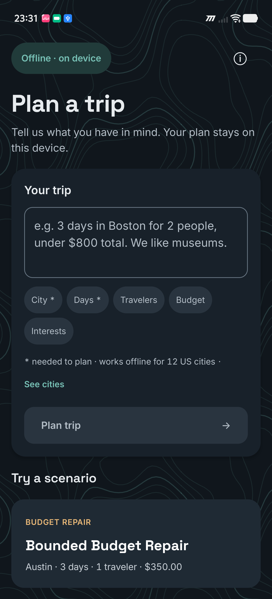
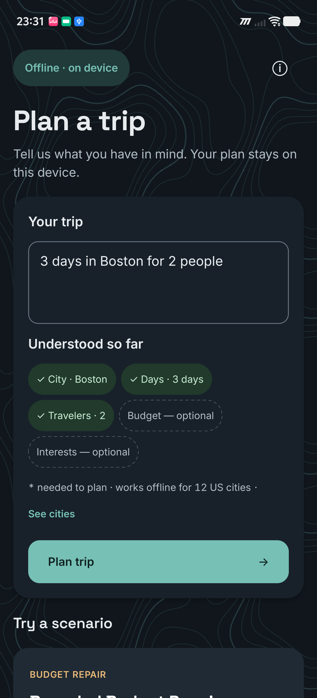
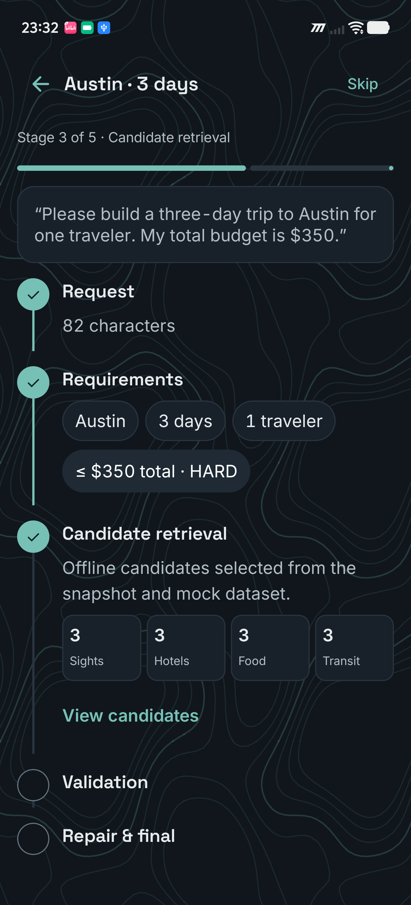
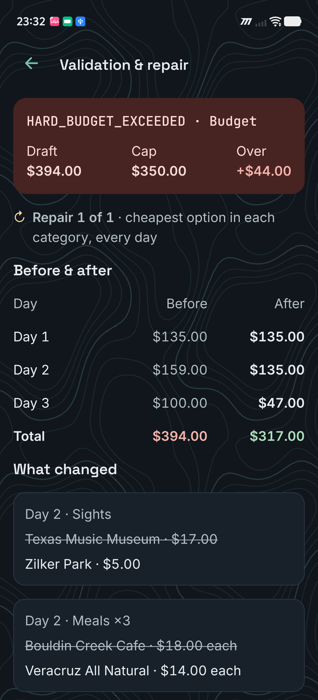
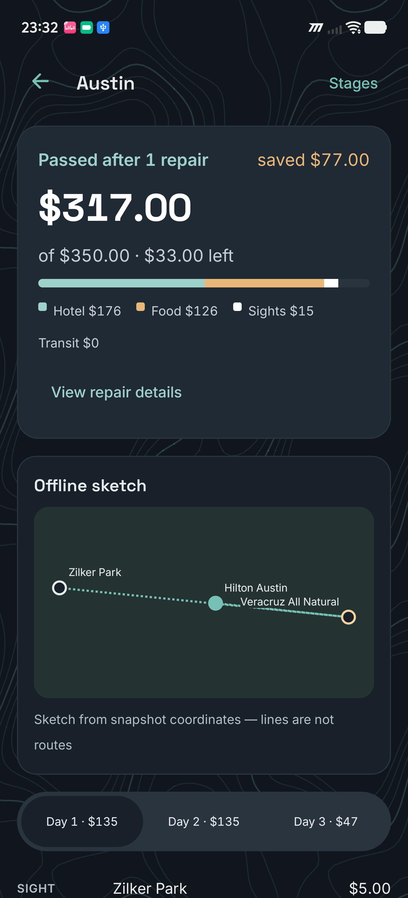
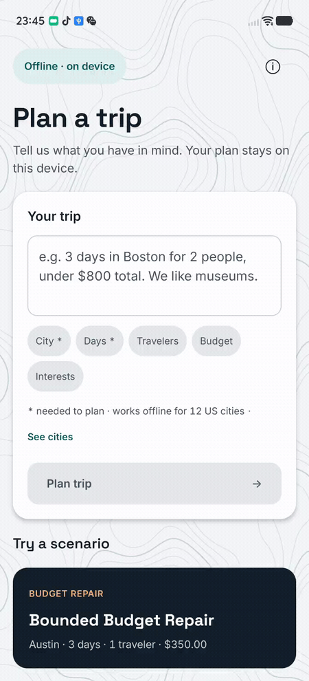
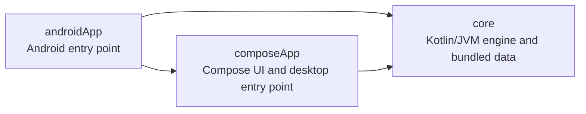
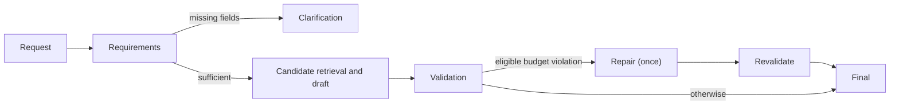

# Travel Agent KMP

[](https://github.com/yudelieyang/travel-agent-kmp/actions/workflows/ci.yml)

A Kotlin Multiplatform port of a Python travel-planning agent that runs fully offline on Android and Desktop. Behavior is verified against the Python reference with 3,591 golden and differential tests and 49,536 regex checks on a real Android device.

| Plan a trip | Live preview | Planning stages | Budget repair | Final plan |
|:---:|:---:|:---:|:---:|:---:|
|  |  |  |  |  |

[More screenshots](docs/screenshots/)



[Watch the ten-second device recording](docs/media/contour-flow.mp4).

## Features

- Plan from an English natural-language request using bundled data for 12 US cities, without a network connection or an LLM.
- Preview recognized trip details, unresolved language and unknown cities while typing; select or correct a destination from the offline list.
- Follow the request, requirements, candidate retrieval, validation, and repair/final stages. Missing destination or duration prompts for clarification.
- Review estimated costs, budget violations and a single low-cost repair attempt, then explore a daily itinerary and an offline coordinate sketch.
- Use adaptive phone and wide-screen layouts, light and dark themes, and a data and limitations page.

## Architecture



The UI presents five stages; clarification can stop the run before retrieval, and eligible budget violations can trigger one repair and revalidation:



`core` contains the deterministic engine, models, bundled city data and snapshots, and parity tests. `composeApp` provides the shared interface and Desktop application. `androidApp` packages the Android application and instrumented tests.

## How parity is verified

The behavioral baseline is the [Python reference implementation](https://github.com/yudelieyang/travel-planning-agent). Runtime comparisons use commit `0f498003c365c8a6d1bb1f066dc3afbd3bdb23fd`; extended fixtures use `5d8983d3e4abc3c914a562f232a5ac060c6864be`. These commits and their expected tags are not currently available from the public repository; see the regeneration notes below. Its deterministic outputs were frozen as JSON golden fixtures, including 28 end-to-end cases, 200 requirements and coverage cases, and extended money cases. Kotlin tests compare outputs with the frozen data; semantic dataset annotations are kept separately from the reference's actual outputs.

Regular expressions are tested against recorded Python search, match, full-match, iteration, split and substitution results, including captures and spans. Parser helpers also have function-level differential fixtures. `PyStr` reproduces the relevant Python case conversion behavior, and `PyRegex` handles JVM and Android regex differences.

Money uses `BigDecimal` with the reference's two-decimal, half-even rounding where the reference quantizes. Operations that the reference performs with binary floating point, including hotel price ceilings and repair savings, follow corresponding `Double` operations. Accepted edge-case differences, including signed zero and extreme numeric values, are documented in [PARITY_EXCEPTIONS.md](PARITY_EXCEPTIONS.md); the full field-level details are in the [fixture specification](core/src/test/resources/golden/SPEC.md).

### Verification results

The following results were recorded for commit `ed7f40c`:

| Check | Result |
| --- | ---: |
| Core golden and differential test suite | 3,591 / 3,591 tests |
| End-to-end fixtures from the original query | 28 / 28 |
| Requirements and coverage fixture parity | 200 / 200 |
| Desktop Compose regression tests | 40 / 40 |
| Preview requirements and coverage versus the engine | 30 / 30 fixtures |
| iQOO 15 Android regex pattern/corpus pairs | 49,536 / 49,536 |
| iQOO 15 Android requirements and coverage fixtures | 200 / 200 |
| iQOO 15 assisted city-selection and preview flows | 2 / 2 |

The 200-case semantic dataset's annotation score was 76 / 200 (38%) for both implementations, with no difference in failure categories. This score is distinct from the 200 / 200 parity result: matching the reference does not establish that an itinerary is feasible. See [semantic comparison](docs/P2_GOLD_COMPARISON.md), [Android parity](docs/P2_ANDROID_PARITY.md), and [acceptance report](docs/P3_ACCEPTANCE.md).

## Run and test

Requirements: JDK 17, the Android SDK with platform 37 and build tools 36.0.0, and an authorized Android device for device tests. Android requires API 26 or later. The Gradle wrapper downloads the required Gradle distribution and dependencies on first use. Commands below are for PowerShell at the repository root; on Linux or macOS, use `bash ./gradlew` in place of `.\\gradlew.bat`.

```powershell
# Desktop application
.\gradlew.bat :composeApp:run

# Build or install the Android debug application
.\gradlew.bat :androidApp:assembleDebug
.\gradlew.bat :androidApp:installDebug

# Core golden/differential tests and Desktop UI tests
.\gradlew.bat :core:test :composeApp:desktopTest

# One golden fixture
.\gradlew.bat :core:test -Pfixture=SEM200-001 --tests "travel.GoldenTest.fixtures"
```

On Desktop, set `JAVA_TOOL_OPTIONS=-Dtravel.background.motion=false` before launching to keep the contour background static; remove the setting to restore animation. On Android, the background follows the system animator duration setting and pauses when the app is not resumed.

On a headless Linux machine, run Desktop tests under a virtual display, for example `xvfb-run -a bash ./gradlew :composeApp:desktopTest`. GitHub Actions runs the full core suite, Desktop suite under Xvfb, and Android debug build on pushes and pull requests.

For device tests, set `ANDROID_HOME`, connect and authorize the device, then install both APKs and run the desired suite:

```powershell
.\gradlew.bat :androidApp:installDebug :androidApp:assembleDebugAndroidTest
& "$env:ANDROID_HOME\platform-tools\adb.exe" install -r androidApp\build\outputs\apk\androidTest\debug\androidApp-debug-androidTest.apk
& "$env:ANDROID_HOME\platform-tools\adb.exe" shell am instrument -w -e class travel.android.AndroidParityTest travel.android.test/androidx.test.runner.AndroidJUnitRunner
python tools/run_android_ui_tests.py travel.android.AssistedGuidanceUiTest 2
```

On the tested iQOO 15, direct instrumentation-triggered Activity startup hung; the assisted script launches the Activity externally. The exact system cause was not established. Device tests are not run in CI.

### Regenerating reference data

The generators expect a checkout of the [Python reference](https://github.com/yudelieyang/travel-planning-agent) in a sibling directory named `travel-planning-agent`, beside this repository. They require the local tags `golden-v1` at `0f498003c365c8a6d1bb1f066dc3afbd3bdb23fd` and `golden-v1.1` at `5d8983d3e4abc3c914a562f232a5ac060c6864be`. Neither tag nor commit is currently obtainable from the public repository, so regeneration from a fresh public clone is blocked until those references are made available. Existing fixtures and tests do not need the Python checkout.

Once both commits are available, run the following from this repository's root. These commands create tags only in the local reference checkout; they do not publish them. The Python environment must have the reference's dependencies installed.

```powershell
git clone https://github.com/yudelieyang/travel-planning-agent.git ../travel-planning-agent
git -C ../travel-planning-agent checkout --detach 0f498003c365c8a6d1bb1f066dc3afbd3bdb23fd
git -C ../travel-planning-agent tag golden-v1 0f498003c365c8a6d1bb1f066dc3afbd3bdb23fd
git -C ../travel-planning-agent tag golden-v1.1 5d8983d3e4abc3c914a562f232a5ac060c6864be
python tools/generate_regex_parity.py
python tools/generate_function_parity.py
python tools/generate_errors_parity.py
```

The generators verify the fixed tag and relevant checked-out source before writing fixtures here. `tools/sync_golden.py` reads the extended fixtures from the second fixed commit. Reference regeneration is not run in CI.

## Limitations

The app is a deterministic demo, not a booking or navigation service. Prices are generated estimates rather than live quotes; taxes, tips, bookings, availability and intercity fares are not checked. Opening hours and dated availability are not validated. The sketch joins snapshot coordinates and is not a route. The bundled coverage is limited to 12 cities and a small set of candidates, so attractions can repeat; unsupported or ambiguous constraints may not be verified. At most one budget repair is attempted. See the in-app data page and [failure catalog](docs/P3_FAILURE_CATALOG.md).

## Data and licenses

The code is licensed under the [MIT License](LICENSE). Bundled place snapshots include data © OpenStreetMap contributors, available under the [Open Database License](https://opendatacommons.org/licenses/odbl/); attribution and snapshot provenance are in [NOTICE.md](NOTICE.md). Candidate prices are project-generated estimates, not OpenStreetMap data. Inter, JetBrains Mono and Space Grotesk are distributed under the SIL Open Font License 1.1; their copyright and license texts are in [licenses/fonts](licenses/fonts/). These data and font licenses remain separate from the code license.
